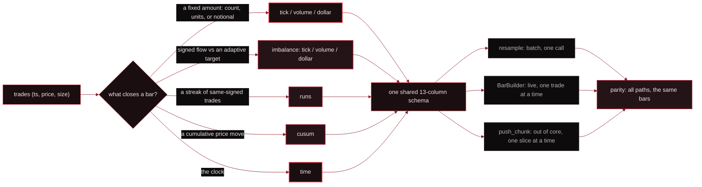
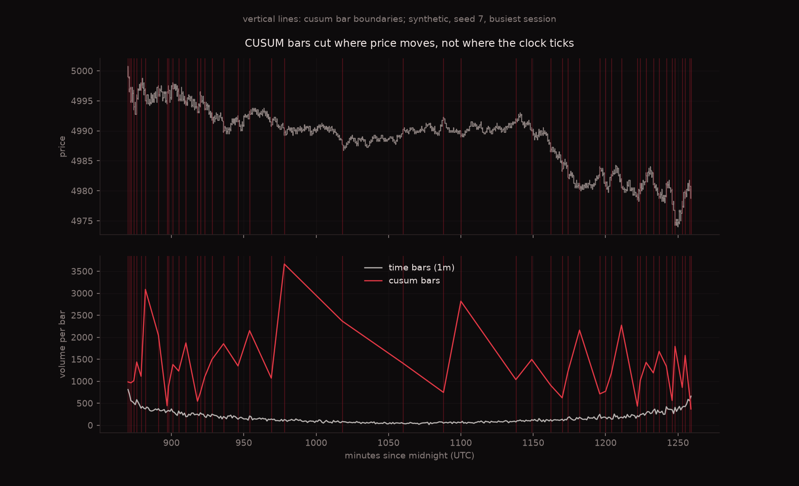
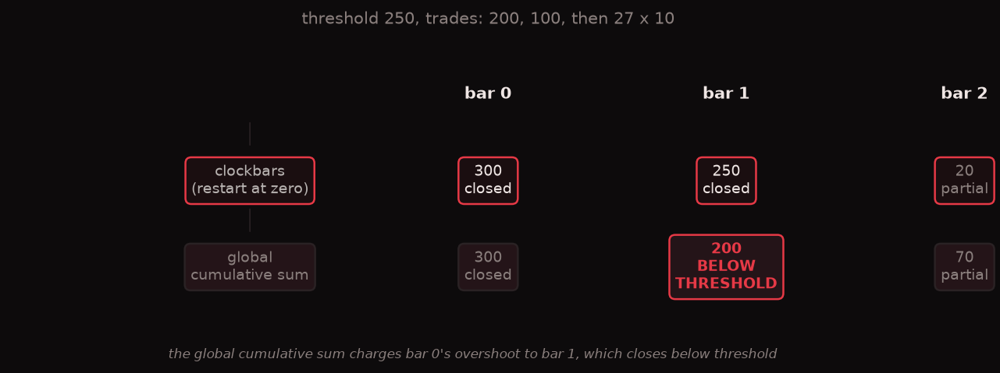
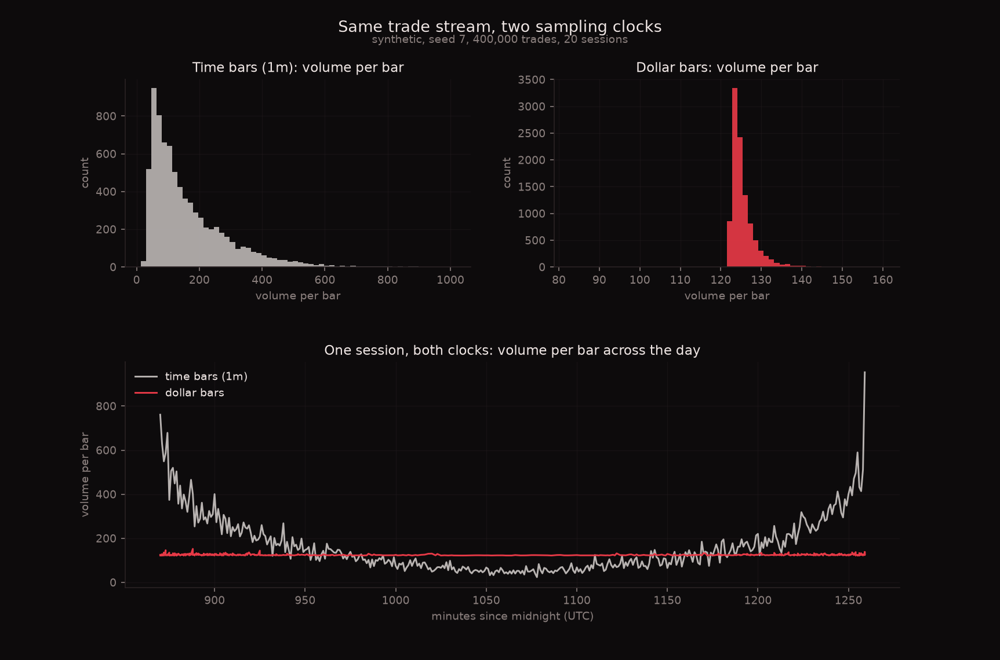

# clockbars

**Bars on the market's clock.** Every bar closes when a set amount of trading
has actually happened. Quiet minutes produce nothing, busy ones produce
plenty. Nine kinds of bars in Polars, built the same way in batch, in a live
stream, and out of core.

[](https://pypi.org/project/clockbars/)
[](https://github.com/zzionz/clockbars/actions/workflows/ci.yml)


---

Most pipelines build bars by clock: take all the trades in each minute, call
it a row, repeat. Markets do not produce information at a constant rate, so
the result is uneven by construction. The first and last half hour of a
session carry several times the volume of midday, which means a 1-minute bar
at 09:31 and a 1-minute bar at 12:31 agree in duration while differing by an
order of magnitude in content. Downstream code treats them as equal rows, and
every statistic computed on the series inherits the unevenness.

Sampling by activity is the old fix, and it has been measured on real data.
Transaction-time sampling cut the mean squared error of a standard variance
estimator by about 5 percent on average, and by as much as 40 percent on
irregular trading days, on IBM transaction data 2000 to 2004 (Oomen, 2006).
The newest large study complicates the case on wash-traded crypto volume
(Grądzki, Wójcik, and Lessmann, 2025). We cite both, on purpose:
[What the evidence says](#what-the-evidence-says).



## Install

```bash
pip install clockbars
```

For development:

```bash
git clone https://github.com/zzionz/clockbars.git
cd clockbars
uv sync --all-extras
uv run pytest -q   # 239 passed, 100% coverage enforced
```

CI runs the full gate set on every push: ruff, strict mypy, and the test
suite with coverage required at 100 percent, on Ubuntu and Windows across
Python 3.11 through 3.14. The package ships a `py.typed` marker, so if you
use clockbars under mypy you get its types, not `Any`.

## Quickstart

Build bars from a sorted stream of trades, all nine kinds returning the
same schema. On the seeded synthetic stream (50,000 trades, 3 sessions):

```python
import polars as pl
from clockbars import resample, synthetic_ticks

trades = synthetic_ticks(n_trades=50_000, n_sessions=3, seed=7)

dollar = resample(trades, kind="dollar", threshold=5_000_000)
minute  = resample(trades, kind="time",   every="1m")
```

```text
50,001 trades -> 160 dollar bars, 1170 one-minute bars

shape: (3, 7)
┌─────────────────────┬─────────────────────┬────────┬─────────┬───────────┬──────────┬────────────┐
│ start_ts            ┆ end_ts              ┆ open   ┆ close   ┆ volume    ┆ n_trades ┆ is_partial │
│ ---                 ┆ ---                 ┆ ---    ┆ ---     ┆ ---       ┆ ---      ┆ ---        │
│ datetime[ns, UTC]   ┆ datetime[ns, UTC]   ┆ f64    ┆ f64     ┆ f64       ┆ u32      ┆ bool       │
╞═════════════════════╪═════════════════════╪════════╪═════════╪═══════════╪══════════╪════════════╡
│ 2019-01-02 14:30:00 ┆ 2019-01-02 14:31:35 ┆ 5000.0 ┆ 5001.5  ┆ 1011.075  ┆ 235      ┆ false      │
│ UTC                 ┆ UTC                 ┆        ┆         ┆           ┆          ┆            │
│ 2019-01-02 14:31:35 ┆ 2019-01-02 14:33:27 ┆ 5001.5 ┆ 5000.5  ┆ 1000.2298 ┆ 210      ┆ false      │
│ UTC                 ┆ UTC                 ┆        ┆         ┆           ┆          ┆            │
│ 2019-01-02 14:33:28 ┆ 2019-01-02 14:35:50 ┆ 5000.5 ┆ 5000.25 ┆ 1000.7881 ┆ 232      ┆ false      │
│ UTC                 ┆ UTC                 ┆        ┆         ┆           ┆          ┆            │
└─────────────────────┴─────────────────────┴────────┴─────────┴───────────┴──────────┴────────────┘
```

### Flow-sampled kinds

Three kinds close on order flow, not on a fixed amount of it, and all
three share one sign convention, the tick rule: a trade is signed +1 on a
rise against the previous trade, -1 on a fall, a flat price carries the
previous sign, and a stream's first trade is +1.

Imbalance bars (Lopez de Prado ch. 2) accumulate the signed metric and close
when it reaches an adaptive target: the expected trades per bar times the
expected per-trade signed metric, both EWMA estimates your seeds start and
only completed bars refine:

```python
flow = resample(trades, kind="dollar_imbalance",
                expected_trades=200, expected_imbalance=5_000.0, window=100)
```

Runs bars close when a streak of consecutive same-signed trades reaches
`E[T] * max(P, 1 - P)`, with `P` an EWMA of the buy fraction. Alternating
flow never builds a streak, so a bar can stay open until a session cut: that
is the rule's honest output, and it is a diagnostic.

```python
runs = resample(trades, kind="runs", expected_trades=60, window=100)
```

CUSUM bars (Page, 1954) are the purest activity clock here: the bar closes
when the cumulative price change since the last reset drifts `h` above its
running minimum or `h` below its running maximum. This is the scheme that
won the only published head-to-head comparison of sampling schemes for
trading (Grądzki, Wójcik, and Lessmann, 2025):

```python
cusum = resample(trades, kind="cusum", h=3.0)
```

```text
cusum (h=3.0) bars in the busiest session:   48
time (1m) bars in the same session:         390
```



The vertical lines are CUSUM bar boundaries: they cluster where price moves
and thin out where it drifts sideways, which is the point.

### Session cuts

Pass the rollover times and accumulation restarts at each boundary. A bar
never spans the overnight close, the boundary trade belongs to the new
session, and a session's final short bar is flagged partial. Works for
every kind except time, which the clock already cuts:

```python
from datetime import UTC, datetime

rollovers = [datetime(2019, 1, d, 14, 30, tzinfo=UTC) for d in (2, 3, 4)]
daily = resample(trades, kind="dollar", threshold=5_000_000,
                 session_starts=rollovers)
```

The rollover itself, from the run above. Day one ends short and flagged; day
two opens a fresh bar on the boundary trade:

```text
last bars of 2019-01-02:
┌─────────────────────────┬───────────┬──────────┬────────────┐
│ end_ts                  ┆ volume    ┆ n_trades ┆ is_partial │
│ ---                     ┆ ---       ┆ ---      ┆ ---        │
│ datetime[ns, UTC]       ┆ f64       ┆ u32      ┆ bool       │
╞═════════════════════════╪═══════════╪══════════╪════════════╡
│ 2019-01-02 20:59:37 UTC ┆ 1005.8586 ┆ 219      ┆ false      │
│ 2019-01-02 20:59:59 UTC ┆ 302.8444  ┆ 62       ┆ true       │
└─────────────────────────┴───────────┴──────────┴────────────┘

first bar of 2019-01-03:
┌─────────────────────────┬───────────┬──────────┬────────────┐
│ start_ts                ┆ volume    ┆ n_trades ┆ is_partial │
│ ---                     ┆ ---       ┆ ---      ┆ ---        │
│ datetime[ns, UTC]       ┆ f64       ┆ u32      ┆ bool       │
╞═════════════════════════╪═══════════╪══════════╪════════════╡
│ 2019-01-03 14:30:00 UTC ┆ 1003.4557 ┆ 220      ┆ false      │
└─────────────────────────┴───────────┴──────────┴────────────┘
```

### Live streams

The same rule runs one trade at a time. `push` a trade, receive a bar when
one closes; `close_session()` at a rollover is the streaming counterpart of
`session_starts`; `flush()` at the end of a stream emits the trailing bar.

```python
from clockbars import BarBuilder

builder = BarBuilder(kind="dollar", threshold=5_000_000)
for ts, price, size in feed:
    bar = builder.push(ts, price, size)   # completed bar, or None
    if bar is not None:
        emit(bar)

trailing = builder.flush()                # the final partial bar
```

### Out of core

`push_chunk` is the vectorised entry point for streams that do not fit in
memory: scan a Parquet file in slices, push each slice, concatenate the
returned frames. A bar open at a slice boundary continues across it, and the
carried state includes the bar's true trade count, so a bar that spans a
hundred slices still closes with the EWMA inputs of one bar:

```python
from clockbars import BarBuilder, bars_to_frame

builder = BarBuilder(kind="dollar", threshold=5_000_000)
frames = []
for chunk in pl.scan_parquet("trades.parquet").collect_batches(100_000):
    frames.append(builder.push_chunk(chunk))
tail = builder.flush()
if tail is not None:
    frames.append(bars_to_frame([tail]))
bars = pl.concat(frames)
```

A parity test holds all three paths, batch and streamed and chunked, to
agreement on everything that decides what a bar is: boundaries, ids,
timestamps, OHLC, counts, partial flags, at 200,000 trades for the threshold
kinds and 100,000 for CUSUM, across slice boundaries that include
single-trade slices and slices that split a bar mid-streak. Per-bar volume
and notional agree to within float-summation order (at most 1e-12 relative),
because a vectorised group sum and a sequential accumulator sum the same
numbers in different orders. From the run above:

```text
batch: 160 bars | streamed: 160 bars
identical boundaries, timestamps, OHLC, flags: True
```

## The rule, and the decisions inside it

A threshold bar closes on the trade that pushes its running total to the
threshold, and that trade is included in the closing bar. Each bar then
restarts from zero. The flow-sampled kinds close on their own targets, all
restart from zero, and a session cut or the end of the stream ends whatever
bar is open, flagged partial. Everything else follows.

Worked example: threshold 250, trades of 200, 100, then 27 trades of 10.
The obvious vectorised implementation is a global cumulative sum, and it has
a defect. It charges each bar's overshoot to the next bar:



The decisions below are each enforced by a named test:

1. **A closed bar's total is always at least its threshold.** It can
   overshoot only by the size of its own final trade.
2. **Overshoot stays in the bar that earned it.** Restarting from zero keeps
   every bar answerable on its own.
   `test_overshoot_is_not_carried_into_the_next_bar` pins this.
3. **The final bar of any segment is kept, flagged, and never dropped.**
   `is_partial=True` means "the segment ended before this bar filled": the
   end of the stream, or the end of a session.
4. **Naive timestamps are rejected.** You get an error telling you to
   declare the zone. Silently assuming UTC is how a DST bug gets born.
5. **NaN and inf are rejected before they can look like data.** In
   floating-point comparison, `NaN <= 0` is `False`, so a sign check alone
   accepts NaN, and one NaN price poisons every bar after it. Finiteness is
   checked separately from sign.
6. **Threshold comparisons carry a `1e-9` relative tolerance.** Summing a
   few thousand floats lands on `499.9999999999999` more often than anyone
   wants to admit. Without the tolerance, those become phantom partial bars.
7. **Duplicate timestamps are fine.** Input order is preserved within a bar,
   so `open`/`close` are stable.
8. **Input must be sorted.** Unsorted input is an error, not a silent
   `sort()`. Sorting implicitly is a policy decision about your data, and it
   is not this library's to make.
9. **Signs follow the tick rule and belong to the stream.** They carry
   across bar and session boundaries, because a trade's sign is a property
   of the trade, not of the bar it lands in.
10. **Adaptive estimates update only on completed bars.** The imbalance and
    runs kinds never look at the bar currently forming, so they are causal
    by construction, not by convention.
11. **A bar carried across chunk boundaries keeps its true counts.** A bar
    open at a slice boundary closes with the length it actually ran, not the
    length visible in one slice, or every adaptive estimate after it
    diverges. `test_chunk_spanning_a_bar_uses_its_true_length` pins this.

Time bars follow the same schema with `is_partial` always `False`. Windows
are half-open `[start, start + every)` and align to wall-clock boundaries: a
frame that begins at 09:30:30 still produces windows that begin on the
minute. Compound intervals like `1h30m` are summed. Empty windows are never
emitted. Session cuts do not apply to time bars, since the clock already
cuts them; passing both raises instead of guessing a precedence.

## Output schema

All nine kinds return the same 13 columns, so nothing downstream has to
branch on how the bars were made:

| Column | Meaning |
| :--- | :--- |
| `bar_id` | zero-based bar index |
| `start_ts`, `end_ts` | first and last trade timestamp in the bar |
| `duration` | `end_ts - start_ts` |
| `open`, `high`, `low`, `close` | first price, max, min, last price |
| `volume` | units traded |
| `notional` | price × size summed |
| `vwap` | `notional / volume` |
| `n_trades` | trade count |
| `is_partial` | `True` only if the bar fell short of its target |

## What the tests actually check

Not "the code runs." The properties that make the output trustworthy:

- volume, notional, and trade counts are conserved exactly across bars;
- bars are chronological and non-overlapping, with `bar_id` contiguous from zero;
- every closed bar meets its threshold, and overshoots by at most one trade;
- only the final bar of a segment can be partial, and the flag agrees with the
  bar's own total;
- OHLC and VWAP are internally consistent (`low ≤ vwap ≤ high`);
- identical input yields identical output;
- bars never straddle a session boundary, with the boundary trade going to
  the new session;
- signs follow the tick rule, in one trade, one chunk, and one stream;
- adaptive estimates update only on completed bars, and a bar carried across
  chunks closes with its true counts;
- the streaming `BarBuilder` matches `resample` exactly on boundaries,
  timestamps, OHLC, counts, and flags, and to 1e-12 relative on sums;
- the chunked `push_chunk` matches both, across slice boundaries that split
  bars mid-streak;
- the whole suite of invariants also runs at 200,000-trade scale, streaming
  and chunked parity included.

Plus every validation rule above, each with the input that breaks it.

## What the evidence says

Three results from three sources. The first is ours and reproducible from a
seed. The other two are published studies on real data, and they point in
opposite directions. All three belong here.

`examples/make_figures.py` builds both figures and prints this table (seed 7,
dollar threshold matched to the median 1-minute notional so the comparison is
fair):

| Sampling | Bars | Volume CV | Excess kurtosis |
| :--- | ---: | ---: | ---: |
| time (1m) | 7,800 | 0.7734 | 1.422 |
| dollar | 10,232 | 0.0255 | −0.007 |



Same 400,000-trade synthetic stream, 20 sessions. Top row: volume per bar is
a long right tail for time bars and a spike for dollar bars. Bottom row:
both clocks across one session, where time-bar volume traces the intraday U
and dollar bars hug a flat line. Volume CV is the coefficient of variation
of per-bar volume: near zero means each bar carries about the same amount
of trading. On this stream, dollar bars hold per-bar volume roughly 30
times steadier than time bars.

On real data, the stakes are higher than shape. Oomen (2006) measured
realized variance under calendar, business, and transaction-time sampling on
IBM transaction data, 2000 to 2004. Transaction time won on every single
day in the sample: the MSE of the estimator fell by about 5 percent on
average and by as much as 40 percent on days with irregular trading. That
is the cost of the old way, priced by someone else's measurement.

The newest study goes the other way, and citing it is the difference between
documentation and marketing. Grądzki, Wójcik, and Lessmann (2025) compared
sampling schemes for BTC and ETH algorithmic trading over 2018 to 2023 with
transaction costs, out of sample. CUSUM-filtered sampling was the only scheme
with consistently positive performance. Dollar bars were the weakest of
everything they tested. Their diagnosis: crypto exchange volume is inflated
by wash trading, so a dollar bar accumulates a partly fabricated signal.

Read together, the lesson is precise. The mechanical claim is settled:
sampling on an honest activity signal gives bars of near-constant information
content, and clock sampling does not. Whether a given activity signal is
honest, and whether an honest one is enough to help a given strategy, are
empirical questions with published answers on both sides. clockbars makes
the choice cheap to test, correct by construction, and identical between
backtest and production. It does not promise the market will cooperate.

## pandas input

If pandas is installed, a `pandas.DataFrame` is accepted and held to the same
validation, with one caveat: Polars converts pandas' timezone-aware datetime
columns through pyarrow, so pandas users need pyarrow too. Naive pandas
timestamps are rejected, same as naive Polars ones.

## Limitations

- Thresholds and CUSUM's `h` are absolute. Choosing one is still your job; a
  defensible default is the median per-minute notional over your sample,
  which is what the example does.
- Threshold bars are not uniform in time. Anything that assumes a fixed bar
  duration (annualisation factors, some indicator definitions) needs
  rethinking before it runs on them.
- The adaptive kinds' seeds matter. Far-from-reality seeds produce the
  documented degenerate behaviour: a zero-ish expected imbalance collapses
  every bar to a single trade. Seed from a sample of your data and check
  the bar counts before trusting the output.
- Session awareness means *your* boundaries: the library ships no exchange
  calendars. You provide the rollover times; `resample` guarantees the cut.
  Rollover contract-adjustment is still your problem.
- Bar segmentation scans over bars, at `O(n_bars · log n_trades)` for the
  threshold kinds and `O(n)` amortised for the flow-sampled kinds. With a
  realistic target there are far fewer bars than trades. A tick threshold
  of 1 on a million trades is inherently one bar per trade and will not be
  fast; nothing makes that a good idea.

## Related work

**[bar-forge](https://github.com/bmouler/bar-forge)** (Mouler, 2026) is the
closest contemporary: tick, volume, dollar, and fixed-threshold imbalance
bars over NumPy trade records, plus strictly causal normalization
transforms, with 100 percent coverage, strict mypy, and a mutation-testing
run (1,208 mutants, 92.96 percent killed). Its bar conventions agree with
ours where they overlap, which we read as both libraries deriving from the
same source. It does not do sessions, streaming, DataFrames, adaptive
estimates, or CUSUM, and it cites no literature. We do all six and ship
[a paper](docs/paper.md).

**mlfinpy** is a free port of the mlfinlab data structures, including the
EWMA-adaptive imbalance and run bars from Lopez de Prado ch. 2, which this
library now implements natively with documented conventions.

**[mlfinlab](https://github.com/hudson-and-thames/mlfinlab)** (Hudson &
Thames) implements the full Lopez de Prado catalogue; it began open source
and is now a commercial product.

Practitioner tooling has followed the same trail: Databento's 2024 guest
series from Double River Investments builds volume and dollar bars in Polars
with a Rust kernel, which is a good sign for the Polars-native path and a
complement to this library.

## Paper

A short paper covering why bar construction matters, the history behind it,
the implementation errors this library exists to prevent, and why batch and
streaming must provably agree, is in
[docs/paper.md](docs/paper.md).

If you use clockbars in research, cite it:

```bibtex
@software{clockbars,
  author = {zzionz},
  title  = {clockbars: bars on the market's clock},
  url    = {https://github.com/zzionz/clockbars},
  version = {1.1.0},
  year   = {2026}
}
```

## License

MIT. See [LICENSE](LICENSE).
